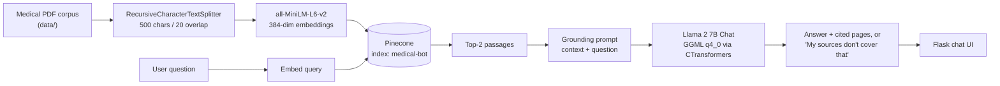

# 🩺 Medical RAG Chatbot

**Medical Q&A grounded in a PDF corpus — built so that "I don't know" is a valid answer.**

[](https://python.org)
[](https://langchain.com)
[](https://huggingface.co/TheBloke/Llama-2-7B-Chat-GGML)
[](https://pinecone.io)
[](https://flask.palletsprojects.com)
[](LICENSE)

---

## The problem

Ask a general-purpose LLM a medical question and it will answer with confidence, and sometimes wrongly. In a medical context that is the entire risk.

This chatbot answers from a specific medical reference corpus and is built to decline when that corpus doesn't cover the question.

## Why refusal is the part worth talking about

Retrieval is the easy half. Chunk, embed, store, search — a solved pipeline, and most RAG tutorials stop there.

The hard half is what happens when retrieval comes back thin. An LLM handed weak context will quietly fall back on its own parametric knowledge, and the user cannot tell the difference — the confident tone is identical either way. In a medical assistant, a plausible-sounding answer assembled from model priors is worse than no answer.

So the system is constructed around a narrower promise: **answer from these documents, or say you can't.**

How that's enforced here:

| Layer | What it does |
|---|---|
| **Grounding prompt** ([`src/prompt.py`](src/prompt.py)) | Instructs the model to answer only from the supplied context, use no other knowledge, and reply "My sources don't cover that." when the context lacks the answer |
| **Stuffed context only** | The chain passes retrieved passages as the sole context — there is no fallback path that answers without retrieval |
| **Narrow retrieval (`k=2`)** | Deliberately tight. Fewer, more relevant passages beat a wide net of loosely-related text that gives the model room to drift |
| **Pages cited** | Ingestion keeps each chunk's source file and page; the API returns them with the answer and the chat UI shows them, so every answer can be checked against the page it came from |

**Where the limits are:** refusal is *prompt-level*. There is no similarity threshold that blocks generation when the top-`k` passages are poor: if retrieval returns two weakly-related chunks, the model still sees them and decides for itself. A threshold alone would not close that gap either: on a local replica of this ingestion pipeline, out-of-corpus *medical* questions scored a top-1 cosine of 0.51–0.64 against 0.55–0.85 for in-scope ones, so a floor catches off-topic questions but not the dangerous middle. The next step is a groundedness check plus an evaluation set — see [Next](#next).

---

## Architecture



### The choices, and why

| Stage | Choice | Reasoning |
|---|---|---|
| Chunking | 500 chars, 20 overlap | Small chunks keep retrieved context tight, which matters more than recall when the goal is grounding. Medical reference text is dense — a 500-char window usually holds one complete idea. |
| Embeddings | `all-MiniLM-L6-v2` | 384 dimensions, runs locally, no API cost. Good enough for single-corpus retrieval; the bottleneck here isn't embedding quality. |
| Vector store | Pinecone | Managed — no index infrastructure to run for a personal project. |
| Retrieval | Top-`k` = 2 | Tight on purpose. More passages means more surface area for the model to wander off. |
| Generation | Llama 2 7B Chat, 4-bit quantised (GGML `q4_0`) via CTransformers, temperature 0.2 | Open weights, runs on CPU, no per-token cost. Quantisation trades some quality for the ability to run it locally at all; low temperature because grounded extraction does not want creativity. |
| Serving | Flask | Small surface. The interesting work is behind the endpoint, not in it. |

---

## Quick start

```bash
git clone https://github.com/MohanVishe/medical-rag-chatbot.git
cd medical-rag-chatbot

python -m venv venv
source venv/bin/activate          # Windows: venv\Scripts\activate
pip install -r requirements.txt   # tested on Python 3.10
```

**1. Configure credentials**

```bash
cp .env.example .env
# fill in PINECONE_API_KEY and PINECONE_API_ENV
```

The app uses the classic `pinecone-client` 2.x API (`pinecone.init` with an environment), which targets pod-based indexes. Moving to the current `pinecone` SDK and serverless indexes is on the [Next](#next) list.

**2. Add the corpus** — see [`data/README.md`](data/README.md). No corpus ships with the repo; drop a medical reference PDF you are licensed to use into `data/`.

**3. Get the model** — download `llama-2-7b-chat.ggmlv3.q4_0.bin` (~3.8 GB) into `model/`. The link is in [`model/instruction.txt`](model/instruction.txt).

**4. Build the index** (once per corpus change. It creates the Pinecone index, dimension 384 and cosine, if it does not exist)

```bash
python store_index.py
```

**5. Run**

```bash
python app.py     # http://localhost:8080
```

### With Docker

```bash
docker build -t medical-rag-chatbot .
docker run -p 8080:8080 --env-file .env -v "$(pwd)/model:/app/model" medical-rag-chatbot
```

The model file is mounted rather than baked in — a multi-GB weight file has no business inside an image layer.

---

## Layout

```
├── app.py              # Flask app, /get returns {answer, sources}, RetrievalQA chain
├── store_index.py      # ingestion: load → chunk → embed → Pinecone, keeping source and page
├── src/
│   ├── helper.py       # PDF loading, chunking, embedding model
│   └── prompt.py       # the grounding prompt — the core of the refusal behaviour
├── templates/          # chat UI
├── static/             # styles
├── model/              # LLM weights (not committed)
├── data/               # corpus (not committed — see data/README.md)
├── Dockerfile
└── requirements.txt
```

---

## Limitations

Stated plainly, because a medical tool that hides its limits is the problem it claims to solve.

- **Not medical advice.** A retrieval demo over one reference text. Nothing here is validated for clinical use.
- **Coverage is the corpus.** Recall is bounded entirely by the source document. Anything outside it gets declined — by design, but it means the system is only as good as what you feed it.
- **Refusal is prompt-level, not guaranteed.** A local probe of the same pipeline showed the failure mode to design against: asked about COVID-19 treatment, the model said its context did not cover it and then answered from its own knowledge anyway.
- **No conversational memory.** Each question is answered independently — follow-ups that depend on the previous turn won't work.
- **Single-document corpus.** Multi-source retrieval would need reranking and per-source attribution.
- **Not yet measured.** Refusal quality has no number behind it until the evaluation set below exists.

## Next

1. **An evaluation set** of in-scope, out-of-corpus-medical and off-topic questions, reporting grounding rate and false-answer rate — so the refusal claim becomes a number.
2. **A groundedness check** between generation and response (NLI or a judge model), backed by a similarity floor for the off-topic case.
3. **Current SDKs:** the `pinecone` SDK with serverless indexes, current LangChain packages, and a GGUF build of a newer open model served through llama.cpp or Ollama.
4. **Reranking** between retrieval and generation, and **hybrid search (BM25 + dense)** — medical terminology is exactly where pure semantic search is weakest.

---

## Credits

Frontend help from **Manish Parihar**.

## License

MIT — see [LICENSE](LICENSE).
